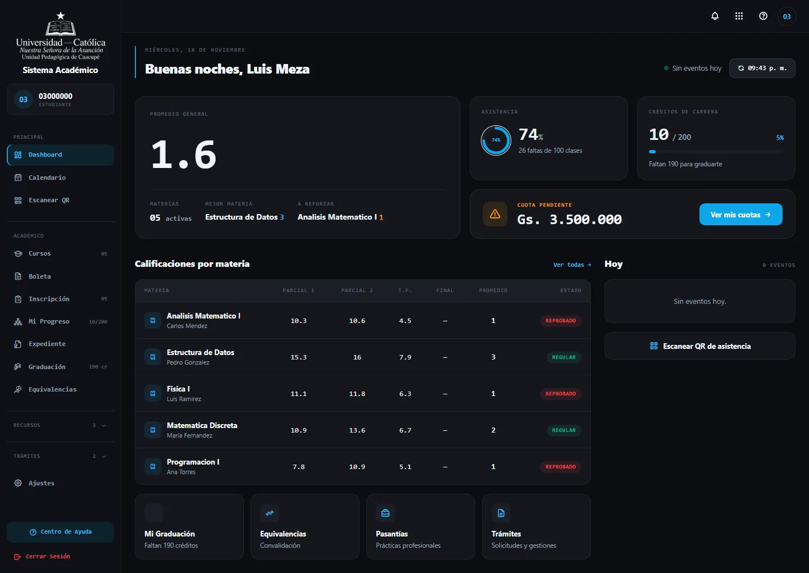
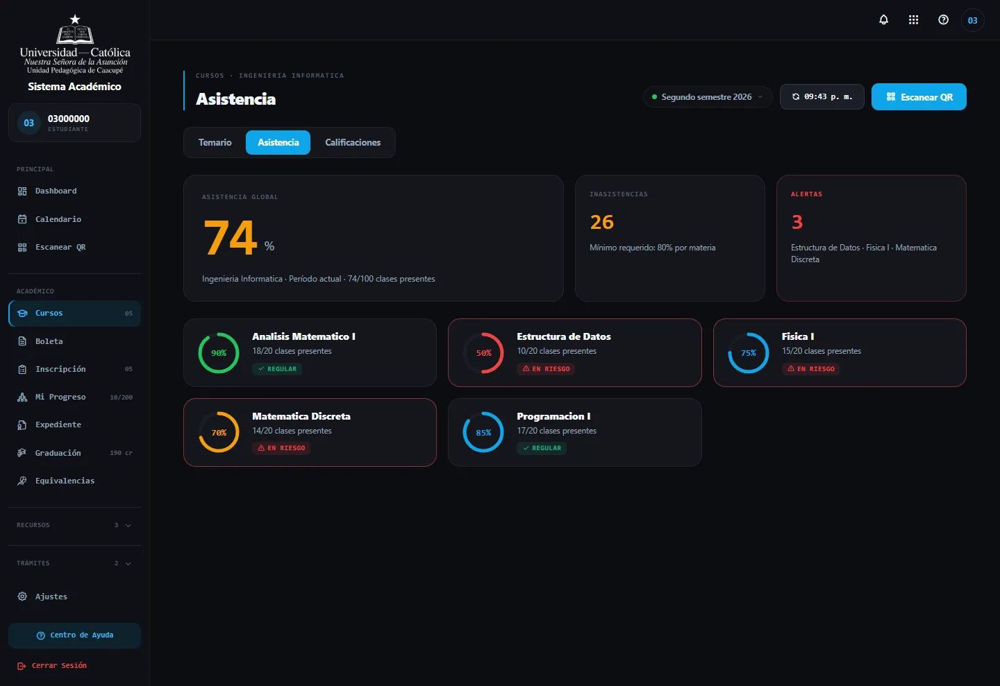
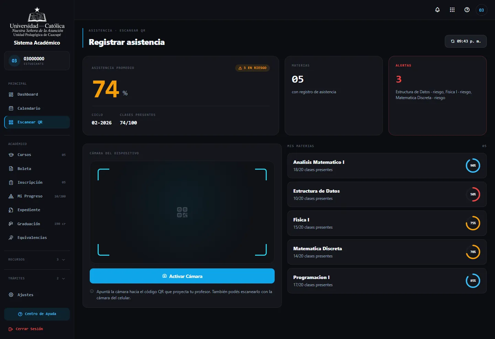
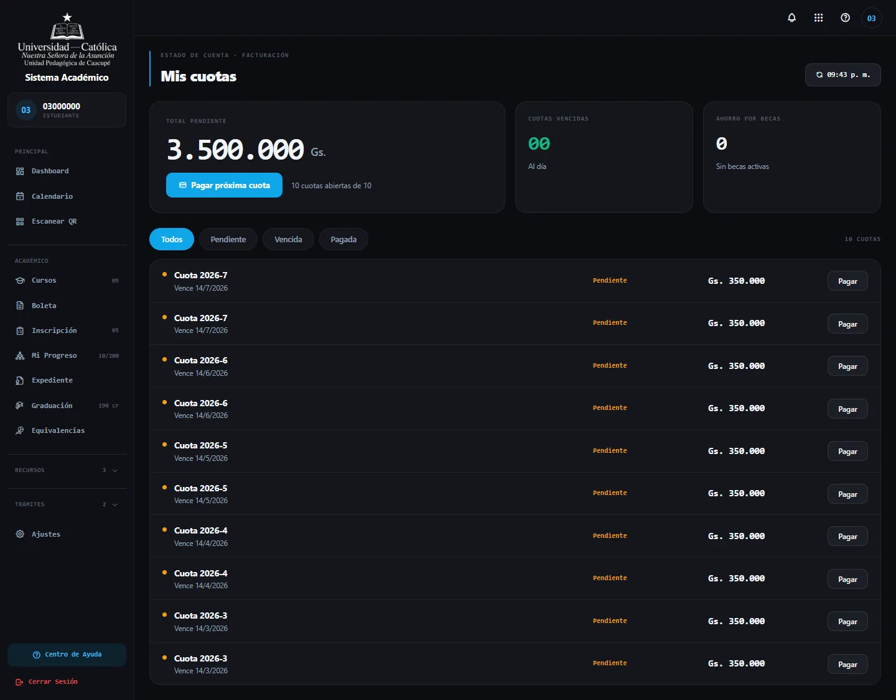
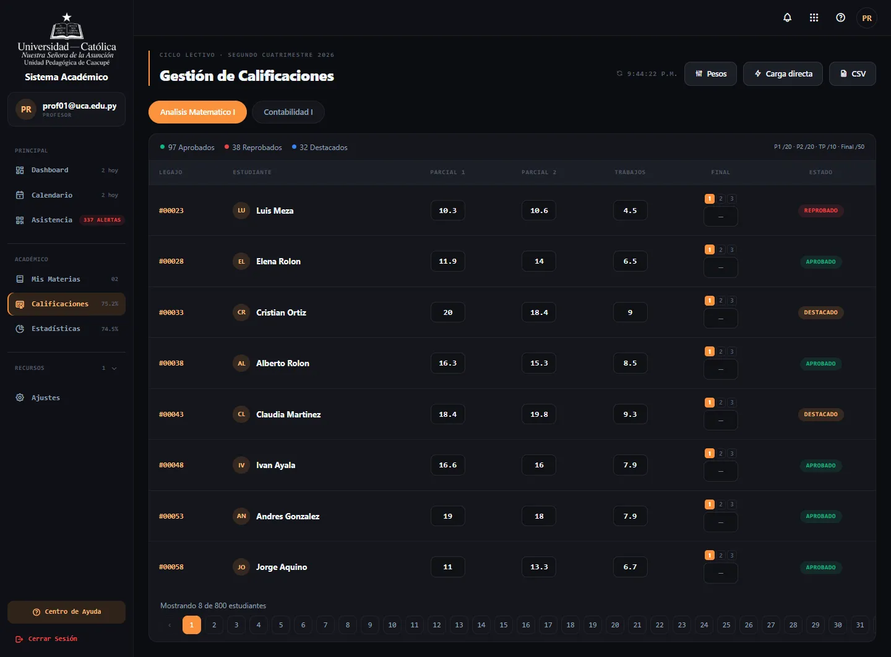
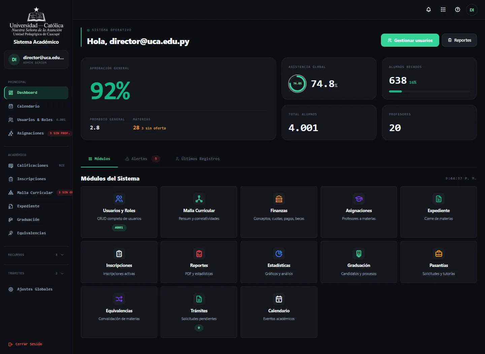
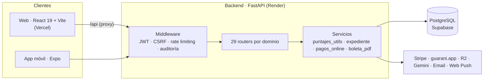

<div align="center">

# Sistema Académico

Sistema de gestión académica para la Universidad Católica «Nuestra Señora de la Asunción», Unidad Pedagógica de Caacupé. Tiene backend en **FastAPI**, frontend web en **React** y app móvil en **Expo**, para los roles **alumno**, **profesor** y **admin**.


</div>

> README técnico para el equipo de desarrollo. El detalle de cada módulo está en [Documentación](#-documentación).

---

##  Entornos

| Entorno | Frontend | Backend | Base de datos |
|---|---|---|---|
| Producción | [sistema-academico-alpha.vercel.app](https://sistema-academico-alpha.vercel.app/login) (Vercel) | `uca-v2-backend.onrender.com` (Render, [`render.yaml`](render.yaml)) | PostgreSQL en Supabase |
| Local | http://localhost:5173 (Vite) | http://localhost:8000 (Uvicorn), Swagger en `/docs` | Postgres local ([`backend/docker-compose.yml`](backend/docker-compose.yml)) o SQLite para la demo |

- El frontend en Vercel reenvía `/api/*` al backend de Render ([`frontend/vercel.json`](frontend/vercel.json)).
- En local, Vite reenvía `/api` y `/static` a `API_PROXY_TARGET` (por defecto `http://127.0.0.1:8000`).
- El plan gratuito de Render apaga el backend por inactividad. El workflow [`keep-alive.yml`](.github/workflows/keep-alive.yml) le pega a `/health`.

**Cuentas de prueba en producción**

| Rol | Usuario | Contraseña |
|---|---|---|
| Alumno | `12345678` | `Alumno1234!` |
| Profesor | `prof@uca.edu.py` | `Profesor1234!` |
| Admin (`/admin`) | `admin@uca.edu.py` | `Admin1234!` |

##  Módulos

| Rol | Módulos | Routers principales |
|---|---|---|
| Alumno | Dashboard, cursos (temario, asistencia, calificaciones), asistencia por QR, boleta con sello HMAC verificable, inscripción, mi progreso, expediente, graduación, equivalencias, becas, pasantías, mis cuotas con Stripe, trámites, biblioteca, calendario | `alumno`, `asistencias`, `boleta`, `inscripciones`, `pensum`, `expediente`, `graduacion`, `equivalencias`, `becas`, `pasantias`, `finanzas`, `tramites` |
| Profesor | Dashboard, QR de asistencia en vivo, gestión de calificaciones por puntos (pesos por materia, 3 finales, CSV), mis materias (activas, histórico y agenda), estadísticas, programa | `profesor`, `asistencias`, `puntajes`, `notas`, `programas`, `reportes` |
| Admin | Usuarios y roles, asignaciones, malla y correlatividades, finanzas (conceptos, cuotas, pagos, becas, facturación con guarani.app), reportes, ajustes globales, import de calendario desde PDF con Gemini | `admin`, `users`, `materia`, `carreras`, `horarios`, `finanzas`, `settings`, `eventos` |

Transversal: JWT con refresh en cookie httpOnly, CSRF double-submit, rate limiting, auditoría, Web Push (VAPID), email con proveedor intercambiable y archivos en Cloudflare R2.

##  Capturas

Tomadas en local con los datos ficticios de los seeds (ver [Demo local](#demo-local-con-sqlite-y-datos-ficticios)).

| Dashboard del alumno | Cursos · Asistencia |
|---|---|
|  |  |

| Escanear QR | Mis cuotas |
|---|---|
|  |  |

| Gestión de calificaciones (profesor) | Panel de administración |
|---|---|
|  |  |

El resto de las capturas (login, boleta, progreso, inscripción, mis materias, usuarios y finanzas) está en [`docs/screenshots/`](docs/screenshots).

##  Arquitectura



##  Stack

| Capa | Tecnología |
|---|---|
| Backend | Python 3.11+, FastAPI, SQLAlchemy 2, Alembic, Pydantic 2, PostgreSQL |
| Frontend web | React 19, TypeScript, Vite 8, Tailwind CSS 4, React Router 7, Recharts, Tabler Icons |
| Mobile | Expo SDK 57, React Native, expo-router, NativeWind 4 |
| Auth | JWT (access en el body, refresh en cookie httpOnly), CSRF double-submit, rate limiting propio, blacklist de tokens |
| Integraciones | Stripe Checkout, guarani.app, Cloudflare R2 (boto3), Gemini, pywebpush, Resend, SendGrid o SMTP |
| PDF y QR | WeasyPrint (boleta), ReportLab, qrcode, jsQR |
| Tests y CI | pytest, Vitest + Testing Library, Jest (mobile), GitHub Actions |

##  Puesta en marcha

### Backend

```powershell
cd backend
python -m venv venv
.\venv\Scripts\Activate.ps1
pip install -r requeriments.txt
copy .env.example .env          # completar DATABASE_URL, JWT_SECRET, etc.
docker compose up -d            # opcional: Postgres local (sa_user / sa_pass)
alembic upgrade head
uvicorn app.main:app --reload --port 8000
```

- Variables de entorno: [`docs/web-system/VARIABLES_ENTORNO.md`](docs/web-system/VARIABLES_ENTORNO.md).
- WeasyPrint necesita GTK en Windows (MSYS2 + pango); el paso a paso está en [`INSTALACION.md`](docs/web-system/INSTALACION.md). Sin GTK, el PDF de la boleta y sus 4 tests fallan con `OSError`.
- `RATE_LIMIT_ENABLED=false` y `CSRF_ENABLED=false` sirven para tests y desarrollo. En producción no se tocan.

### Demo local con SQLite y datos ficticios

Sirve para levantar algo navegable sin Postgres ni secretos. `DATABASE_URL` definida en la terminal tiene prioridad sobre el `.env`.

```powershell
cd backend
$env:DATABASE_URL = "sqlite:///./demo.db"
$env:TEST_DATABASE_URL = $env:DATABASE_URL
$env:PYTHONPATH = "."
python -c "import app.main; from app.database import Base, engine; Base.metadata.create_all(bind=engine)"
python scripts/seed_pensum_piloto.py
python scripts/seed_masivo.py
python scripts/seed_restante.py
uvicorn app.main:app --port 8000
```

| Rol | Usuario | Contraseña |
|---|---|---|
| Admin (`/admin`) | `director@uca.edu.py` | `Director1234!` |
| Profesor | `prof01@uca.edu.py` … `prof20@uca.edu.py` | `Profesor1234!` |
| Alumno | cédula del seed, por ejemplo `03000000` | `Alumno1234!` |

> `seed_completo.py` quedó desactualizado respecto del modelo `Materia` (usa `profesor_id`) y falla. Usar los tres scripts de arriba.

### Frontend

```powershell
cd frontend
npm install
npm run dev                     # http://localhost:5173
# backend en otro puerto: $env:API_PROXY_TARGET = "http://127.0.0.1:8010"
```

##  App móvil

```powershell
cd mobile
npm install
npx expo start                  # Expo Go (SDK 57) o dev client
```

| Pantalla | Archivo | Servicio |
|---|---|---|
| Login, registro y recuperación (con biometría) | `app/(auth)/login.tsx` | `authService` |
| Inicio, cursos y perfil | `app/(tabs)/index.tsx`, `cursos.tsx`, `perfil.tsx` | `dashboardService` |
| Horario | `app/(tabs)/horario.tsx` | `calendarioService` |
| Detalle de curso | `app/cursos/[id].tsx` | — |
| Escáner QR | `app/scanner.tsx` | `asistenciaService` |
| Exámenes | `app/examenes.tsx` | `examenesService` |
| Cuenta (cuotas y pago online) | `app/cuenta.tsx` | `cuentaService` |

- URL del backend: `EXPO_PUBLIC_API_BASE`, si no `extra.apiBase` de `app.json`, y si no `http://localhost:8000` (ver `services/api.ts`).
- **Builds locales:** `expo` carga `mobile/.env` al compilar. Si ese archivo tiene una IP de LAN, el APK queda apuntando a esa IP. Para compilar contra producción hay que exportar `EXPO_PUBLIC_API_BASE=https://uca-v2-backend.onrender.com` antes de `gradlew assembleRelease`, o usar los perfiles `preview`/`production` de [`eas.json`](mobile/eas.json).
- Expo Go solo abre proyectos de su mismo SDK. Con otra versión hay que usar un dev client (`eas build --profile development`).

##  Comandos frecuentes

| Tarea | Comando |
|---|---|
| Tests backend | `cd backend; python -m pytest -q` |
| Tests frontend | `cd frontend; npm run test:run` |
| Lint y tipos frontend | `cd frontend; npm run lint; npx tsc -p tsconfig.app.json --noEmit` |
| Build frontend | `cd frontend; npm run build` |
| Tests y tipos mobile | `cd mobile; npm test; npm run typecheck` |
| Lint y tipos backend | `npm run check:backend` (ruff + mypy, desde la raíz) |
| Nueva migración | `cd backend; alembic revision --autogenerate -m "descripcion"` |
| Aplicar migraciones | `cd backend; alembic upgrade head` |

Estado al 2026-11-18: el backend pasa 399 tests (4 de PDF requieren GTK), el frontend 20 de 20 con el build OK y mobile 10 de 10 con `tsc` limpio.

##  Estructura

```text
backend/
  app/
    main.py              # app FastAPI, CORS, middlewares, routers
    routers/             # 29 routers por dominio
    services/            # lógica de negocio (puntajes_utils, expediente, pagos_online, boleta_pdf…)
    models/  schemas/    # SQLAlchemy y Pydantic
    middleware/          # CSRF
    dependencias.py  rate_limiting.py  security.py  audit.py
  alembic/versions/      # 42 migraciones
  scripts/               # seeds de datos ficticios
  tests/                 # pytest (SQLite en memoria, ver conftest.py)
frontend/src/
  pages/                 # una vista por ruta; la mayoría separa la vista por rol
  components/            # Layout (sidebar por rol), paneles compartidos, common/PageKpi.tsx
  services/              # clientes de la API por módulo
  lib/api.ts             # JWT, refresh single-flight y header CSRF
  styles/design-tokens.css
mobile/
  app/                   # expo-router: (auth), (tabs), cursos/[id], scanner, examenes, cuenta
  services/  hooks/  components/  __tests__/
docs/                    # ver Documentación
```

##  Convenciones

**Backend**
- La regla de rol va en cada endpoint (dependencias de `app/dependencias.py`) y además se valida la pertenencia del recurso para evitar IDOR. Ejemplo: `_verificar_profesor_materia` en `asistencias_router.py`.
- La nota final se calcula **solo** con `calcular_promedio_final()` en `services/puntajes_utils.py`: puntos sobre los pesos de `pesos_evaluacion` (20/20/10/50 por defecto), mapeados a la escala entera 1–5. No reimplementar promedios en los routers.
- Todo cambio de modelo va con su migración de Alembic. En los tests se usa `create_all` sobre SQLite.

**Frontend**
- Los colores salen de `design-tokens.css`. `--accent` cambia por rol con `[data-role]`: alumno celeste, profesor naranja, admin verde.
- **Rediseño "jerarquía por foco" (Fase 20, en curso):** cada vista usa `PageHead` (eyebrow, título y acciones con `RefreshButton`) y `KpiRow` (un KPI dominante más secundarios), de `components/common/PageKpi.tsx`. No armar headers a mano. Falta migrar Expediente, Equivalencias, Becas, Pasantías, Trámites (alumno), Asistencia en vivo, Mis Materias y Gestión de Calificaciones (profesor).
- La barra lateral arranca con Recursos y Trámites colapsados. Los tests de `Layout` cuentan solo los ítems visibles.
- Las vistas con datos en vivo hacen polling cada 30 s y tienen refresh manual.

**Documentación**
- Al cerrar o modificar una fase, actualizar [`ESTADO_FASES.md`](docs/web-system/ESTADO_FASES.md) y la referencia que corresponda (`API_REFERENCE.md`, `MODELO_DATOS.md`, `FRONTEND_REFERENCE.md`).

##  CI y deploy

- [`ci.yml`](.github/workflows/ci.yml): en push a `main`, `develop` y `push-final`, corre en el backend `alembic upgrade head` y pytest sobre Postgres, y en el frontend `npm ci`, lint, tests y build.
- Backend en Render: `pip install` y `alembic upgrade head` en el build, `uvicorn` en el start. Frontend en Vercel. Paso a paso en [`GUIA_DEPLOY_PRODUCCION.md`](docs/web-system/GUIA_DEPLOY_PRODUCCION.md).
- Los secretos (Stripe, VAPID, guarani.app, R2, SMTP, `JWT_SECRET`) viven solo en el panel de cada servicio. `backend/.env` y `mobile/.env` están en `.gitignore`.

##  Documentación

| Carpeta | Contenido |
|---|---|
| `docs/web-system/` | `CLAUDE.md` (reglas del proyecto), `COMANDOS.md`, `ESTADO_FASES.md`, `ARQUITECTURA.md`, `API_REFERENCE.md`, `MODELO_DATOS.md`, `FRONTEND_REFERENCE.md`, `SERVICIOS.md`, `VARIABLES_ENTORNO.md`, `INSTALACION.md`, `GUIA_DEPLOY_PRODUCCION.md`, `ESTADO_PRODUCCION.md` |
| `docs/app-mobile-system/` | `CHANGELOG_MOBILE.md`, `PLAN_DESARROLLO_MOBILE.md`, `EXPO_GO_TESTING.md`, `CLAUDE.md`, `AGENTS.md`, `analisis_app_mobile.md` |
| `docs/auditorias/` | `AUDITORIA_2026-07-24.md`, `PLAN_FIXES_AUDITORIA.md`, `CHANGELOG_FIXES.md` (fuente de verdad de los fixes de seguridad) |
| `docs/documentacion-tecnica/` | `DOCUMENTACION_TECNICA_TOTAL.md`, `RESUMEN_TECNICO_COMPLETO.md`, `CHANGELOG_TECNICO.md` |
| `docs/negocio/` | `PLAN_DESARROLLO_UNIVERSIDAD.md`, `PLAN_VENTAS_UNIVERSIDADES.md` |

##  Equipo

WebPy Studio.
